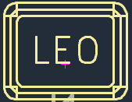
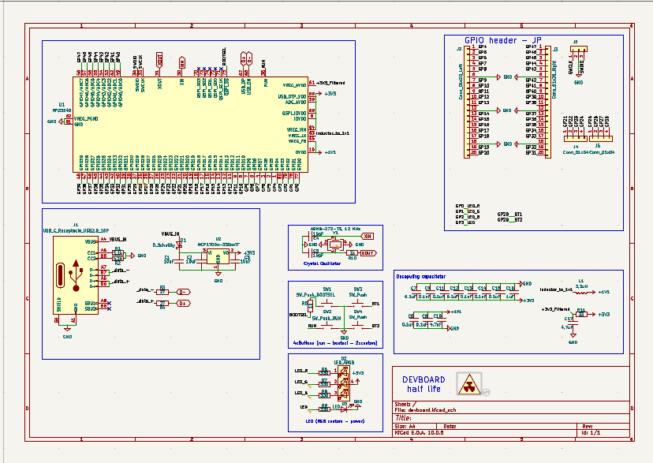
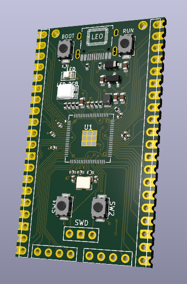
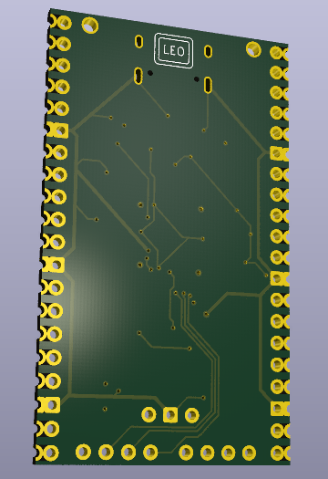
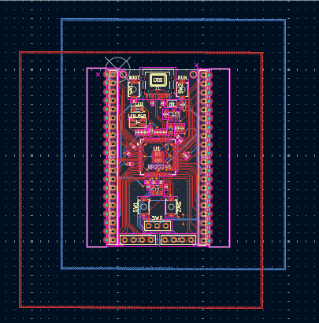
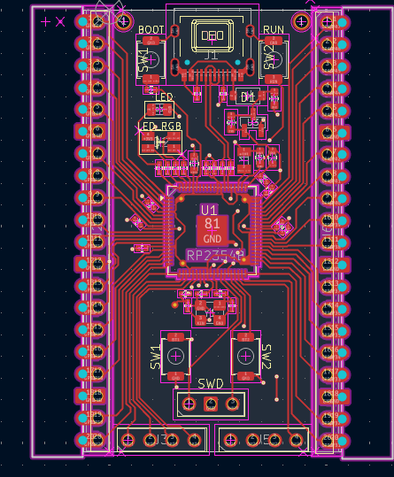
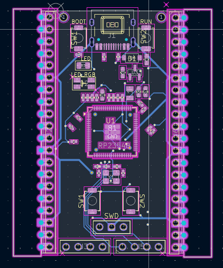
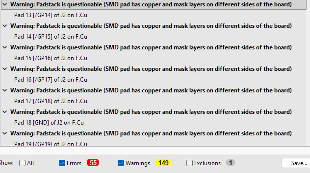

# Devboard

Devboard is a custom Raspberry Pi RP2354B development board based on the [Hack Club devboard guide](https://stasis.hackclub.com/starter-projects/devboard). The schematic and PCB are being designed in KiCad.

## Why this board?

I wanted to design a microcontroller board itself, with USB-C, GPIO, onboard buttons and status LEDs.

## Parts

- Raspberry Pi RP2354B microcontroller
- USB-C connector
- 3.3 V power supply with an inductor and a Schottky diode
- Yellow  LED and a RGB LED
- BOOTSEL, RUN and 2 user buttons
- 2.54 mm pin headers, plus additional headers, SWD debug probe

## CAD Model
No case yet.

## PCB

The KiCad project is in [`PCB/`](PCB/). Open the [KiCad project](PCB/devboard.kicad_pro) to view the schematic and board together. Custom footprints and 3D models are stored beside the KiCad files.

### Schematic

The current schematic includes the RP2354B circuit, USB-C, power, buttons and LEDs.

[Pinout](PCB/devboard_pinout.svg)

### Board

The schematic now matches the PCB references, footprints and electrical nets. Assembly files still need to be checked before ordering.

Front and rear of the PCB:

Copper layers:

## Firmware Overview

Firmware has not been added yet.

## BOM

The [BOM for one board](BOM.csv) includes JLCPCB links and the quantities in the saved parts cart. It is a design BOM; the JLCPCB assembly BOM and placement file are still pending.

## AI usage

AI assistance was used for parts research(both selcetin what component and find th ecorrect one on sites),also for KiCad advice. The schematic, footprint and PCB still was done by hand by me.

## Extra stuff
Its questionable to me too

